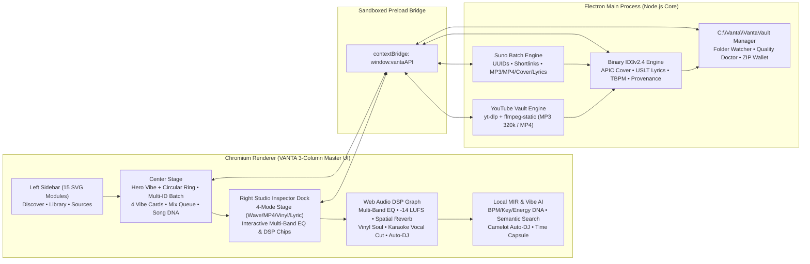

# VANTA — Personal Audio & Video OS: Final Master Implementation Plan

## Goal Description

Build **VANTA** (`C:\Vanta`), an enterprise-grade, offline-first **All-in-One Personal Audio & Video Operating System** for Windows and macOS (with a Web UI architecture portable to Android via Capacitor). VANTA is engineered on the same industry-standard desktop media stack used by **Spotify** and **Tidal** (**Electron + Node.js + Chromium Web Audio DSP Graph + HTML5 Video Engine + `electron-builder` NSIS `.exe` Installer**), completely independent of `c:\SecureShield`.

The UI implements the finalized **VANTA Master 3-Column Desktop Architecture** ([vanta_final_master_mockup.html](file:///C:/Users/ahmt_/.gemini/antigravity/brain/80bbf5fe-f776-422f-a56e-70cb0bfa9d5b/vanta_final_master_mockup.html)):
1. **Topbar (`56px`)**: Brand mark (`VANTA` + `C:\Vanta\VantaVault` path indicator), **Natural-Language Semantic Search Bar** (*“melancholic night drive synthwave 120–128 BPM”*), `Local AI Ready` status pill, Acoustic Device Profile selector (*Headphones Profile*, *Studio Monitors*, *Late-Night Car*, *Concert Hall*), and **3-Theme Switcher** (**`Obsidian`** default, **`Slate`**, **`Ice`**).
2. **Left Sidebar (`245px`) — Custom Duotone Neon SVG Icons & Gradient-Border Active Pill**:
   - **DISCOVER**: `Home`, `Vibe Radio`, `Song DNA`, `Time Capsule`
   - **LIBRARY**: `Tracks` (with count badge), `Albums`, `Artists`, `Playlists` (with count badge), `Video Clips` (MP4 badge), `DJ Studio`, `AI Remix`
   - **SOURCES**: `Suno Importer` (`Batch` badge), `YouTube Vault`, `Local Files` (`C:\Vanta\VantaVault`), `Vault & Doctor` (health issue count badge)
3. **Center Stage (`1fr`)**:
   - **Hero Vibe Banner** with ambient conic glow orb, harmonic mix actions (*Start Vibe Radio*, *Edit Mix & 5-Band EQ*, *Save Mix to Vault*), and integrated **Pinterest Circular Batch Progress Ring (`0%–100%`)**.
   - **Tactile Recessed Universal Multi-ID / URL Batch Importer Bar** accepting single or multiple **Suno UUIDs**, `suno.com/song/...` links, `suno.com/s/...` shortlinks, and **YouTube URLs**, with segmented export pills (`MP3 + ID3`, `MP4 Video`, `FLAC`, `ZIP`).
   - **4 Personalized Vibe Discovery Cards** (*Neon Resonance*, *After Hours Phonk*, *Blue Hour Ambient*, *Istanbul Sunset*).
   - **Bottom Split**: **Upcoming Mix & Batch Queue** on the left + **Song DNA Tri-KPI Panel (`BPM`, `Key`, `Energy %`, multi-gradient DNA bar, mood chips)** & **Universal Media Vault Dropzone (`C:\Vanta\VantaVault`)** on the right.
4. **Right Studio Inspector Dock (`320px`)**:
   - **4-Mode Now Playing Visual Stage** (`Wave` 60 FPS Rounded-Bar + Spline Curve | `🎬 Video` HD MP4 Player with PiP | `💿 Vinyl` Spinning Vinyl Soul Turntable | `🎤 Lyric` Synchronized Karaoke Lyrics + Vocal Remover) + quick spatial/DSP chips (*Spatial*, *Adaptive EQ*, *Karaoke*, *Vinyl Soul*).
   - **Audio Studio DSP & Interactive Multi-Band Live Equalizer Card** with clickable/draggable gain bars and mastering chips (*Loudness -14 LUFS*, *Reverb*, *Saturation*, *Bass Boost*).
5. **Persistent Bottom Master Player Bar (`84px`)**:
   - Single unified transport (`Shuffle`, `Prev`, `Play/Pause`, `Next`, `Save MP3 + ID3`), mini artwork/status toast, interactive timeline scrubber, and live **Auto-DJ Beat-Sync Crossfade** telemetry.

---

## Finalized Design & Configuration Decisions

> [!IMPORTANT]
> - **Standalone Root Directory**: `C:\Vanta` (completely separate from `c:\SecureShield`).
> - **Default Media Vault Location**: `C:\Vanta\VantaVault\` (with automatic subfolders `/Suno/`, `/YouTube/`, `/Local/`, and `/Exports/`, plus an in-app folder picker so the user can point VANTA to any additional local directories).
> - **Default Theme**: **`Obsidian`** (Vantablack `#07070D` with Violet `#7C5CFF`, Cyan `#00E5FF`, Rose `#FF4D8D`, and Amber `#FFD166` ambient radial accents), with instant 1-click switching to **`Slate`** and **`Ice`** in the top bar.

---

## Master Execution Checklist (Living Tracker)

We will update and check off (`[x]`) each item in both this artifact and `C:\Vanta\PLAN.md` as implementation progresses:

- [x] **Phase 1: Project Foundation & Secure Electron Architecture (`C:\Vanta`)**
  - [x] Initialize `C:\Vanta\package.json` with Electron, `ffmpeg-static`, `electron-builder` (NSIS `.exe` Setup + Portable `.exe`), and automated test scripts
  - [x] Create `C:\Vanta\PLAN.md` mirror for in-repo milestone tracking and initialize `C:\Vanta\VantaVault\` (`/Suno`, `/YouTube`, `/Local`, `/Exports`)
  - [x] Implement custom desktop window, System Tray, global Media Keys, custom `vanta-media://` streaming protocol, and strict IPC security (`contextIsolation: true`, `sandbox: true`) in `electron/main.cjs` and `electron/preload.cjs`
- [x] **Phase 2: Universal Acquisition, Binary ID3v2.4 & Storage Engine (Pillars D, E, F, G)**
  - [x] Build **Suno Batch Resolver & Downloader** (`electron/services/sunoService.cjs`) supporting single/multi UUIDs, full `suno.com/song/...` URLs, and `suno.com/s/...` shortlinks (`MP3`, `MP4 Video`, `Cover JPEG`, `Lyrics/Prompt`)
  - [x] Build **Binary ID3v2.3/v2.4 Reader & Writer** (`electron/services/id3Service.cjs`) to embed and parse `APIC` Cover Art, `TIT2` Title, `TPE1` Artist, `TCON` Genre, `TBPM` BPM, `USLT` Lyrics, and AI Provenance tags
  - [x] Build **YouTube Audio/Video Engine** (`electron/services/youtubeService.cjs`) interfacing with `yt-dlp` and `ffmpeg-static` for `320kbps MP3` and `1080p MP4` acquisition with embedded cover thumbnails
  - [x] Build **Local Library, Quality Doctor & Portable Wallet Service** (`electron/services/libraryService.cjs`) scanning `C:\Vanta\VantaVault\` and user folders, detecting SHA-256/acoustic duplicates and missing ID3 tags, and exporting `.zip` / `.vanta` wallets
- [x] **Phase 3: Studio Web Audio DSP Graph & Dual-Deck Crossfade Engine (Pillar C)**
  - [x] Build **Web Audio DSP Graph** (`src/js/audioEngine.js`) routing `<audio>` and `<video>` elements through:
    - Multi-Band Parametric Equalizer (`BiquadFilterNode` cascade) + Device Profiles (*Headphones Profile*, *Studio Monitors*, *Late-Night Car*, *Concert Hall*)
    - Loudness Normalizer & Mastering Compressor (`DynamicsCompressorNode` at `-14 LUFS`)
    - Spatial Stereo Widener & Convolver Reverb (`ConvolverNode`)
    - **Mid-Side Vocal Cancellation Filter** for instant **Karaoke Mode**
    - **Vinyl Soul Engine** (tube saturation `WaveShaperNode` + procedural vinyl crackle generator)
    - **Slowed + Reverb / Nightcore** real-time pitch & playback-rate controller
    - **Dual-Deck Auto-DJ Crossfader** (`0s–12s` beat-synced overlap)
- [x] **Phase 4: Music Information Retrieval (MIR), Song DNA & Vibe Radio AI (Pillars A, B, F, H)**
  - [x] Build **MIR & Song DNA Analyzer** (`src/js/mirAnalyzer.js`) computing BPM, Key, Energy %, Danceability, Spectral Centroid, Vocal Presence, and Mood chips (*Melancholic*, *Night Drive*, *Analog Synth*, *High Energy*)
  - [x] Build **Vibe Radio, Semantic Search & Conversational Mood-to-Mix Engine** (`src/js/vibeRecommender.js`) with cosine DNA similarity, Camelot key transition scoring, contextual bandits, and **Time Capsule** analytics
- [x] **Phase 5: Finalized VANTA Master 3-Column UI & 4-Mode Stage (`src/`)**
  - [x] Build `src/index.html` and `src/styles/vanta.css` matching [vanta_final_master_mockup.html](file:///C:/Users/ahmt_/.gemini/antigravity/brain/80bbf5fe-f776-422f-a56e-70cb0bfa9d5b/vanta_final_master_mockup.html) with all 15 Duotone Neon SVG Left Sidebar modules, 3 themes (`Obsidian`, `Slate`, `Ice`), Top Semantic Search Bar, Hero Vibe Banner + Circular Progress Ring, Universal Multi-ID Importer, Right 4-Mode Studio Dock (`Wave` / `Video` / `Vinyl` / `Lyric` + Interactive EQ), and Unified Bottom Player Bar
  - [x] Build `src/js/visualizer.js` and `src/js/app.js` wiring all 15 sidebar views, live 60 FPS Rounded-Bar + Spline Wave `<canvas>`, drag-and-drop file import, and IPC batch download progress
- [x] **Phase 6: Verification, Automated Tests & Windows Setup Packaging**
  - [x] Run automated test suite (`tests/vanta.test.mjs`) verifying Multi-ID/URL resolution, ID3v2.4 binary injection/parsing, MIR Song DNA & BPM analysis, Semantic Search, and Quality Doctor
  - [x] Launch live VANTA Desktop Studio (`npm start`) and verify all UI flows
  - [x] Package Windows installer/distributable (`npm run build:win`) into `C:\Vanta\dist\`

---

## System Architecture



---

## Proposed Changes (`C:\Vanta`)

### 1. Project Root & Configuration
- #### [NEW] [package.json](file:///C:/Vanta/package.json)
- #### [NEW] [PLAN.md](file:///C:/Vanta/PLAN.md)

### 2. Electron Main Process & Media Services (`C:\Vanta\electron\`)
- #### [NEW] [main.cjs](file:///C:/Vanta/electron/main.cjs)
- #### [NEW] [preload.cjs](file:///C:/Vanta/electron/preload.cjs)
- #### [NEW] [sunoService.cjs](file:///C:/Vanta/electron/services/sunoService.cjs)
- #### [NEW] [youtubeService.cjs](file:///C:/Vanta/electron/services/youtubeService.cjs)
- #### [NEW] [id3Service.cjs](file:///C:/Vanta/electron/services/id3Service.cjs)
- #### [NEW] [libraryService.cjs](file:///C:/Vanta/electron/services/libraryService.cjs)

### 3. Renderer UI, Web Audio DSP & MIR Intelligence (`C:\Vanta\src\`)
- #### [NEW] [index.html](file:///C:/Vanta/src/index.html)
- #### [NEW] [vanta.css](file:///C:/Vanta/src/styles/vanta.css)
- #### [NEW] [audioEngine.js](file:///C:/Vanta/src/js/audioEngine.js)
- #### [NEW] [mirAnalyzer.js](file:///C:/Vanta/src/js/mirAnalyzer.js)
- #### [NEW] [vibeRecommender.js](file:///C:/Vanta/src/js/vibeRecommender.js)
- #### [NEW] [visualizer.js](file:///C:/Vanta/src/js/visualizer.js)
- #### [NEW] [app.js](file:///C:/Vanta/src/js/app.js)

### 4. Automated Verification Suite (`C:\Vanta\tests\`)
- #### [NEW] [vanta.test.mjs](file:///C:/Vanta/tests/vanta.test.mjs)

---

## Verification Plan

### Automated Tests
```powershell
cd C:\Vanta
npm test
```

### Live Desktop & Installer Verification
```powershell
cd C:\Vanta
npm start
npm run build:win
```
