# VANTA Pro Audio DSP Yükseltme Planı

> [!NOTE]
> Bu plan VANTA’nın **Studio DSP (32-Bit Float Web Audio)** motorunu gerçek profesyonel ses işleme devreleriyle güçlendirir. **WASAPI Exclusive + DoP v1.1** yolu tamamen bit-perfect kalmaya devam eder; yeni DSP katmanları hem müziklerde hem de `Direct GPU` videolarda anında duyulabilir, sıfır lisanslı ve %100 offline çalışır.

## Hedeflenen Sinyal Akışı

```mermaid
flowchart LR
  SRC["Deck A / Deck B / Video"] --> RG["EBU R128 ReplayGain"]
  RG --> KAR["Mid-Side Vocal Remover"]
  KAR --> EQ10["10-Band EQ + AutoEQ + Sub-Bass"]
  EQ10 --> EXC["Harmonic Exciter (4.5kHz+)"]
  EXC --> PITCH["Pitch Shift (±6 st AudioWorklet)"]
  PITCH --> XF["Bauer Headphone Crossfeed"]
  XF --> SPAT["3D Binaural & M/S Spatializer"]
  SPAT --> TUBE["Analog Tape / Vinyl Warmth"]
  TUBE --> REV["Early-Reflection + Hall Reverb"]
  REV --> COMP["Night Compressor + True-Peak Limiter (-1 dBFS)"]
  COMP --> OUT["Analyser + Master Output"]
```

---

## Faz 1 — Profesyonel DSP Çekirdeği ([audioEngine.js](file:///C:/Vanta/src/js/audioEngine.js))

- [x] **1.1 Gerçek Binaural 3D Spatializer (`Spatial 3D`):**
  - Mevcut `%7 reverb` yerine gerçek **Mid-Side (`L+R` / `L-R`)** matrisi kurulumu.
  - `160 Hz` yüksek geçiren filtre ile yalnızca orta/üst frekansların (`Side`) genişletilmesi (bas fazının bozulmaması için alt frekansların merkezde tutulması).
  - Kulakta doğal oda genişliği ve Dolby Headphones benzeri sahne derinliği oluşturan mikro Haas (`0.65 ms`) + çok hafif erken yansıma katmanı (*Width %0 – %150*).
- [x] **1.2 Kulaklık Crossfeed (Bauer / Meier Doğal Monitör Sahnesi):**
  - `700 Hz` alçak geçiren filtre + `260 µs` kanal gecikmesiyle sol kanalın düşük frekanslı doğal akustik gölgesini sağa (ve sağdan sola) karıştırma; kulaklık yorgunluğunu azaltma.
- [x] **1.3 Gerçek Sub-Bass & Dynamic Bass Boost (`Bass Boost`):**
  - Genel sesi kıstığı için etkisini kaybeden `+3 dB` yapı yerine `70 Hz` Sub-Bass shelf (`+5.5 dB`) ve `120 Hz` Punch (`+2.5 dB`) + çıkış limiter koruması ile net hissedilen dolgun bas.
- [x] **1.4 Harmonic Exciter / Crystalizer (`Exciter`):**
  - `4.5 kHz` üzerini izole edip hafif harmonik doygunluktan geçirerek paralel ekleme; özellikle MP3 ve YouTube akışlarında donuk tizleri ve detay netliğini canlandırma.
- [x] **1.5 Master Compressor & True-Peak Limiter (`Limiter` / `Night Mode`):**
  - `DynamicsCompressorNode` ile arka plan korumalı True-Peak Limiter (`-1.5 dBFS`) ve seçilebilir **Night Mode** (fısıltıları belirginleştirip ani patlamaları yumuşatma).
- [x] **1.6 Karakterli Salon Reverb & Sıcak Vinyl/Tape (`Reverb`, `Vinyl Soul`):**
  - Reverb karışımını duyulabilir seviyeye (`%22`) ve doğal pre-delay'e (`18 ms`) yükseltme.
  - Vinyl Soul için sıcak analog bant doygunluğu + ince dinamik çıtırtı dokusu.
- [x] **1.7 10-Band EQ + Genişletilmiş Kulaklık AutoEQ Profilleri:**
  - `31 Hz` ve `16 kHz` eklenerek **10-Band** (`31, 62, 125, 250, 500, 1k, 2k, 4k, 8k, 16k`) hassas ekolayzır.
  - Profesyonel hedef profiller: `Bit-Perfect (Flat)`, `Harman Target (In-Ear)`, `TWS / AirPods Clarity`, `Studio Monitors`, `Cinema Spatial`, `Late-Night Warm`, `Club Hi-Fi`.
- [x] **1.8 Gerçek Zamanlı Pitch Shift (`AudioWorklet`, ±6 Yarım Ton):**
  - Hızı (`1.00x`) değiştirmeden ses perdesini ±6 yarım ton kaydıran offline `src/js/pitchWorklet.js` modülü.

---

## Faz 2 — Pro DSP Rack Arayüzü ([index.html](file:///C:/Vanta/src/index.html), [vanta.css](file:///C:/Vanta/src/styles/vanta.css), [app.js](file:///C:/Vanta/src/js/app.js))

- [x] **2.1 Güncellenmiş Hızlı DSP Çipleri (Sağ Panel):**
  - Mevcut kompakt düzeni koruyarak çipleri gerçek işlevleriyle güncelleme:
    `EBU R128`, `Spatial 3D`, `Crossfeed`, `Bass Boost`, `Exciter`, `Reverb`, `Limiter`, `Karaoke`, `Vinyl Soul`, `DoP v1.1` + **`🎛️ DSP Rack`** açma butonu.
- [x] **2.2 Açılır Studio DSP Rack Paneli / `DJ Studio` Entegrasyonu:**
  - **10-Band Grafik Ekolayzır** sütunları + presetler (`Flat`, `Vanta Mastering`, `Bass & Punch`, `Vocal Clarity`, `Spatial Cinema`, `Night Listening`).
  - İnce ayar slider'ları: *Spatial Width (%)*, *Crossfeed (%)*, *Bass Boost (dB)*, *Exciter (%)*, *Reverb Mix (%)*, *Pitch (±6 st)*.
  - `Night Mode` ve `Bit-Perfect Reset` butonları.
- [x] **2.3 Kalıcı DSP Hafızası:**
  - Kullanıcının tüm DSP ince ayarlarının `localStorage` (`vanta_pro_dsp_v1`) üzerinden kaydedilip açılışta geri yüklenmesi.

---

## Faz 3 — Doğrulama, Testler ve Windows Paketleme ([tests/vanta.test.mjs](file:///C:/Vanta/tests/vanta.test.mjs))

- [x] **3.1 DSP Matematik & Durum Birim Testleri:**
  - 10-band EQ kalibrasyonu, Mid-Side Spatial enerji hesabı, Bauer Crossfeed parametreleri, Exciter & Limiter kalibrasyonu ve preset/state kalıcılığı testleri.
- [x] **3.2 Uçtan Uca Kalite ve Build Doğrulaması:**
  - `node --check` tüm değiştirilen JS/worklet dosyaları
  - `npm test` tüm birim testleri
  - `npx electron . --verify-smoke` + `vanta_live_window.png` görsel kontrolü
  - `npm run build:win` ile güncel `VANTA Setup 1.0.0.exe` ve taşınabilir `VANTA 1.0.0.exe` üretimi
